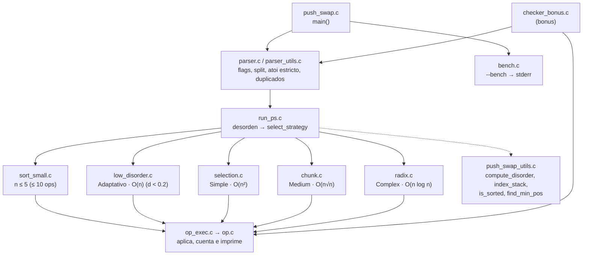
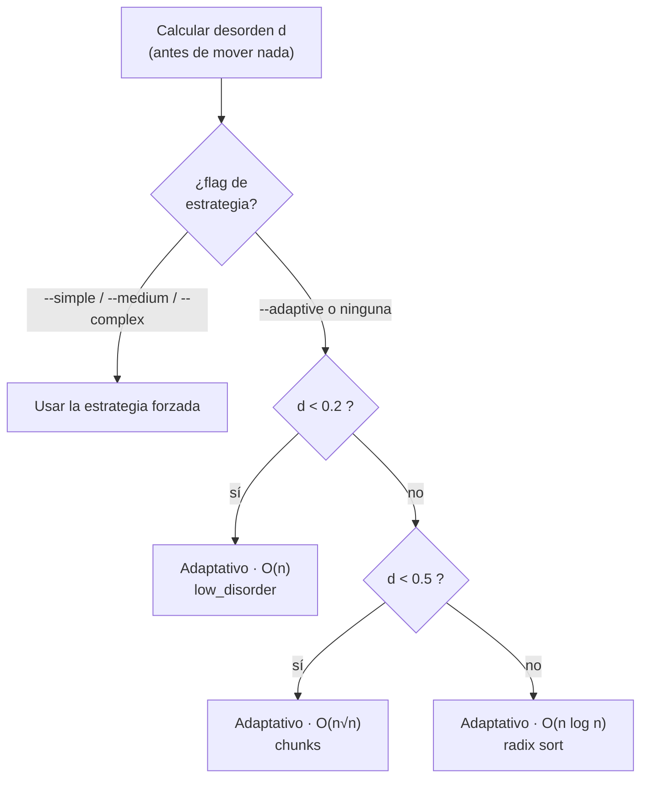
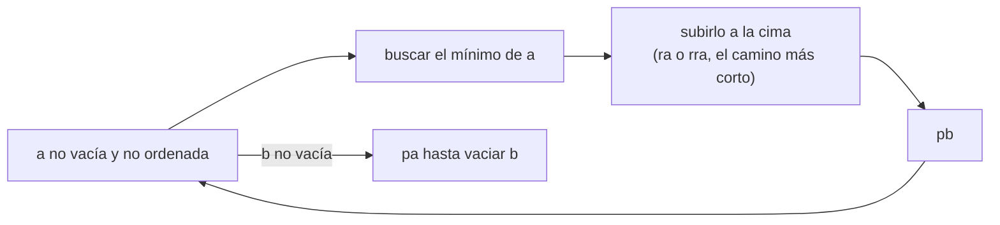
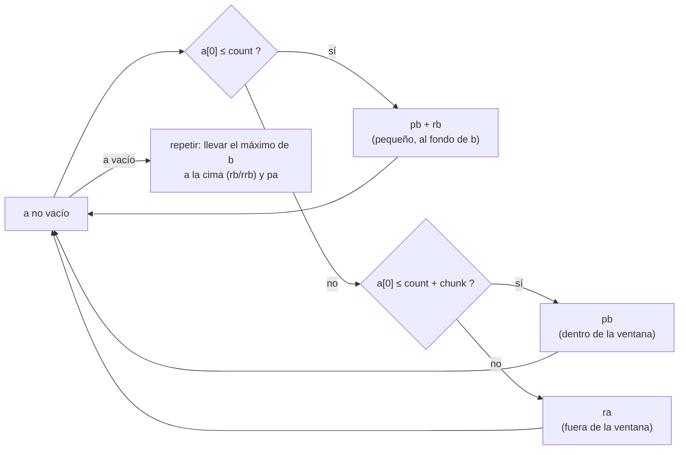
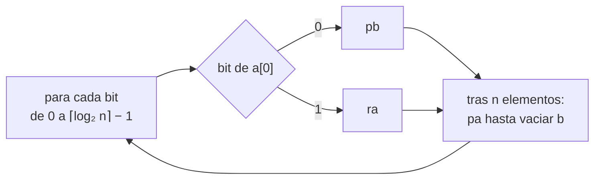
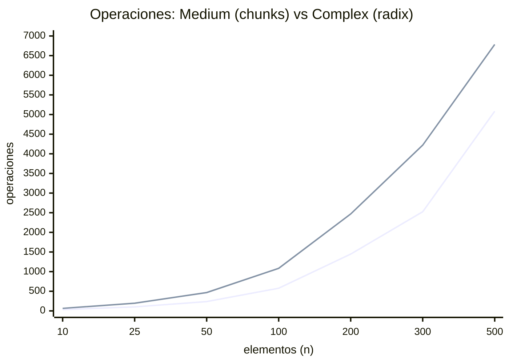

*Este proyecto ha sido creado como parte del currículo de 42 por alavryk, alsadyko.*

# push_swap

## Descripción

**push_swap** es un proyecto de algoritmia del currículo de 42. Dada una lista de enteros en la pila `a` y una pila `b` vacía, el programa imprime la secuencia de instrucciones más corta posible que deja `a` ordenada de forma ascendente (el número más pequeño en la cima), usando solo un conjunto limitado de operaciones.

El objetivo no es solo ordenar, sino hacerlo con el menor número de movimientos posible. La complejidad se mide en **número de operaciones de push_swap generadas**, no en tiempo de CPU.

### Operaciones permitidas

| Instrucción | Descripción |
|-------------|-------------|
| `sa` / `sb` / `ss` | Intercambia los dos primeros elementos de `a` / `b` / ambas |
| `pa` / `pb` | Mueve el primer elemento de `b` a `a` / de `a` a `b` |
| `ra` / `rb` / `rr` | Rota hacia arriba `a` / `b` / ambas (el primero pasa a ser el último) |
| `rra` / `rrb` / `rrr` | Rota hacia abajo `a` / `b` / ambas (el último pasa a ser el primero) |

### Funcionamiento general

1. **Parseo y validación**: acepta números como argumentos separados o en una cadena entre comillas (`"3 2 1"`), o mezclando ambos. Rechaza valores no numéricos, fuera del rango de `int` y duplicados; en esos casos imprime `Error` por `stderr` y termina con código 1.
2. **Índice de desorden**: antes de mover nada se calcula la proporción de pares `(i, j)` con `i < j` y `a[i] > a[j]` (entre 0 y 1).
3. **Normalización**: cada valor se sustituye por su rango (`0 … n-1`), lo que simplifica las comparaciones.
4. **Estrategia y casos pequeños**: se determina la estrategia según la flag indicada o el índice de desorden en el modo adaptativo; si el tamaño de `a` es $\le 5$, se aplica una resolución directa optimizada (`sort_small`) en $\le 10$ operaciones.
5. **Salida**: una operación por línea en `stdout`. Si la lista ya está ordenada no se imprime nada.



### Algoritmos

El proyecto implementa tres algoritmos base, un régimen lineal para bajo desorden en modo adaptativo y un caso base optimizado para entradas pequeñas ($\le 5$ elementos).

| Estrategia / régimen | Flag / condición | Algoritmo | Complejidad (en operaciones) |
|----------------------|------------------|-----------|------------------------------|
| Simple | `--simple` | Selection sort | O(n²) |
| Medium | `--medium` | Ordenación por chunks | O(n√n) |
| Complex | `--complex` | Radix sort binario (LSD) | O(n log n) |
| Adaptive (desorden `< 0.2`) | `--adaptive` (por defecto) | Rotación / pasada lineal | O(n) |
| Adaptive (desorden `0.2 ≤ d < 0.5`) | `--adaptive` (por defecto) | Ordenación por chunks | O(n√n) |
| Adaptive (desorden `≥ 0.5`) | `--adaptive` (por defecto) | Radix sort binario (LSD) | O(n log n) |

#### Casos pequeños (`n ≤ 5`)

Cuando la pila tiene hasta 5 elementos, se extraen los mínimos sucesivos a `b` hasta dejar 3 elementos en `a`, se ordenan esos 3 con un árbol de decisiones mínimo y se devuelven los elementos desde `b` con `pa`. Esto garantiza como máximo 10 operaciones independientemente de la estrategia o del índice de desorden.

#### Simple: selection sort, O(n²)

Mientras `a` tenga elementos y no esté ordenada, busca el mínimo, lo sube a la cima con `ra` o `rra` (el sentido más corto) y lo pasa a `b` con `pb`, devolviendo luego todo con `pa`. Cada extracción cuesta hasta $n/2$ rotaciones y se repite hasta $n$ veces, de ahí O(n²).

#### Medium: chunks, O(n√n)

Se recorre `a` y se empujan a `b` los elementos cuyo índice cae en una ventana de tamaño `chunk ≈ 1.4·√n` que avanza con el contador de elementos ya enviados: los más pequeños se mandan al fondo de `b` (`pb` + `rb`) y el resto de la ventana se queda arriba. Después se devuelve siempre el máximo de `b` con `pa`, rotando por el camino más corto. Con $\sqrt{n}$ bloques y hasta $n/\sqrt{n}$ rotaciones por elemento se obtiene O(n√n). El factor 1.4 se eligió de forma empírica porque minimizaba el número de operaciones.

#### Complex: radix sort, O(n log n)

Como los valores son índices `0 … n-1`, se necesitan $\lceil\log_2 n\rceil$ pasadas. En cada una, para cada bit: los elementos con ese bit a 0 pasan a `b` (`pb`) y los de bit 1 rotan (`ra`); después se devuelve todo `b` a `a`. Cada pasada cuesta como mucho $2n$ operaciones, así que el total es O(n log n) y, además, el número de operaciones apenas depende del orden inicial.

#### Adaptive: elección según el desorden

| Desorden | Estrategia usada | Complejidad | Justificación de umbrales y técnica |
|----------|------------------|-------------|--------------------------------------|
| `d < 0.2` | `low_disorder` | O(n) | Con `d < 0.2` el stack está casi ordenado o desplazado circularmente: comprobar rotación circular y aplicar pasadas locales con `sa`/`ra` lleva un número de operaciones lineal respecto al tamaño/desplazamiento |
| `0.2 ≤ d < 0.5` | `chunk` | O(n√n) | Desorden intermedio: el reparto en bloques de tamaño $\approx 1.4\sqrt{n}$ acota los desplazamientos a O(n√n) |
| `d ≥ 0.5` | `radix` | O(n log n) | Desorden alto: radix evita costes cuadráticos y mantiene una cota predecible de O(n log n) operaciones |

Los umbrales `0.2` y `0.5` siguen las cotas establecidas en el enunciado para cada régimen del modo adaptativo.



#### Cómo ordena cada algoritmo

**Selection sort**



**Chunks**



**Radix (LSD, por bits)**



#### Operaciones según el tamaño (simulación)

Media de 5 listas aleatorias, con una simulación en Python que reproduce la lógica de `selection.c`, `chunk.c` y `radix.c`. No son medidas del binario: úsalo con `--bench` para obtener las reales.

| n | Simple | Medium | Complex |
|---|--------|--------|---------|
| 10 | 29 | 34 | 65 |
| 50 | 427 | 237 | 467 |
| 100 | 1419 | 577 | 1084 |
| 200 | 5500 | 1446 | 2468 |
| 500 | 32025 | 5083 | 6784 |



Primera serie: Medium (chunks). Segunda: Complex (radix). Selection sort queda fuera de la gráfica porque con n = 500 llega a más de 32 000 operaciones y aplastaría el resto.

#### Análisis de complejidad

| | Tiempo (nº de operaciones) | Espacio |
|---|---|---|
| Bajo desorden (`d < 0.2`) | O(n) | O(n) |
| Selection | O(n²) | O(n) |
| Chunks | O(n√n) | O(n) |
| Radix | O(n log n) | O(n) |

El espacio extra es O(n): dos arrays de enteros de tamaño `n` (pilas `a` y `b`) más un array temporal durante la normalización. Ninguna estrategia usa memoria adicional proporcional a las operaciones.

### Prueba de rendimiento

Objetivos del enunciado:

| Elementos | Mínimo | Bueno | Excelente |
|-----------|--------|-------|-----------|
| 100 | < 2000 | < 1500 | < 700 |
| 500 | < 12000 | < 8000 | < 5500 |

### Flag `--bench`

Con `--bench` el programa imprime por `stderr`, tras ordenar: el índice de desorden, la estrategia seleccionada con su complejidad, el total de operaciones y el desglose por tipo (`sa`, `sb`, `ss`, `pa`, `pb`, `ra`, `rb`, `rr`, `rra`, `rrb`, `rrr`). La salida de operaciones por `stdout` no se ve afectada.

```
[bench] disorder: 49.87%
[bench] strategy: Adaptive / O(n log n)
[bench] total_ops: 1083
[bench] sa: 0 sb: 0 ss: 0 pa: 541 pb: 542
[bench] ra: 0 rb: 0 rr: 0 rra: 0 rrb: 0 rrr: 0
```

> Ejemplo ilustrativo del formato; ejecuta `./push_swap --bench …` para ver tus valores reales.

### Bonus

- **`checker`**: recibe la pila `a` como argumentos, lee instrucciones de la entrada estándar (una por línea) y las aplica. Muestra `OK` si `a` queda ordenada y `b` vacía, `KO` en caso contrario, y `Error` por `stderr` si hay argumentos inválidos o una instrucción desconocida o mal formada.

## Instrucciones

### Requisitos

- `cc` (gcc o clang)
- `make`

### Compilación

```bash
make        # compila ./push_swap
make bonus  # compila ./checker
make clean  # borra los objetos
make fclean # borra objetos y binarios
make re     # fclean + all
```

### Uso

```bash
./push_swap 2 1 3 6 5 8
./push_swap "3 2 1 0"

# Selección de estrategia (las flags van antes de los números)
./push_swap --simple   5 4 3 2 1
./push_swap --medium   5 4 3 2 1
./push_swap --complex  5 4 3 2 1
./push_swap --adaptive 5 4 3 2 1   # por defecto

# Estadísticas por stderr
./push_swap --bench 5 4 3 2 1
```

Manejo de errores:

```bash
$ ./push_swap --adaptive 0 one 2 3
Error
$ ./push_swap --simple 3 2 3
Error
```

### Pruebas

Contar movimientos y comprobar con el checker:

```bash
ARG=$(shuf -i 0-1000 -n 100 | tr '\n' ' ')
./push_swap $ARG | wc -l
./push_swap $ARG | ./checker $ARG
```

Comparar estrategias:

```bash
ARG=$(shuf -i 0-1000 -n 500 | tr '\n' ' ')
for s in simple medium complex adaptive; do
  ./push_swap --bench --$s $ARG 2>&1 >/dev/null | grep -E "strategy|total_ops"
done
```

Fugas de memoria:

```bash
valgrind --leak-check=full ./push_swap 5 4 3 2 1
```

### Estructura del repositorio

```
.
├── Makefile
├── includes/
│   └── push_swap.h
├── libft/               # libft + get_next_line
└── srcs/
    ├── push_swap.c        # main
    ├── parser.c           # flags y lectura de argumentos
    ├── parser_utils.c     # atoi estricto, duplicados, liberación de memoria
    ├── push_swap_utils.c  # desorden, indexado, utilidades de pila
    ├── run_ps.c           # selección de estrategia
    ├── op.c               # operaciones básicas sobre pilas
    ├── op_exec.c          # ejecución, impresión y conteo de operaciones
    ├── sort_small.c       # ordenación optimizada para n ≤ 5
    ├── low_disorder.c     # régimen adaptativo O(n) para desorden < 0.2
    ├── selection.c        # estrategia simple O(n²)
    ├── chunk.c            # estrategia media O(n√n)
    ├── radix.c            # estrategia compleja O(n log n)
    ├── bench.c            # salida de --bench
    └── checker_bonus.c    # checker (bonus)
```

## Contribuciones

| Persona  | Contribución                                                                                                                                                                                                                                                                                                                                                                                                                                                                                                                                                                                                    |
| -------- | --------------------------------------------------------------------------------------------------------------------------------------------------------------------------------------------------------------------------------------------------------------------------------------------------------------------------------------------------------------------------------------------------------------------------------------------------------------------------------------------------------------------------------------------------------------------------------------------------------------- |
| alavryk  | * **Operaciones de las pilas:** Implementación de los movimientos base (`sa`, `sb`, `ss`, `pa`, `pb`, `ra`, `rb`, `rr`, `rra`, `rrb`, `rrr`) y su trazabilidad/conteo. * **Algoritmos y optimización:** Lógica de ordenación de algoritmos simple, complex, régimen de bajo desorden y casos pequeños ($\le 5$). * **Parseo y validación de entrada:** Gestión de argumentos, detección de duplicados, desbordamientos (`INT_MIN` / `INT_MAX`), entradas no numéricas y liberación limpia de memoria en caso de error. * **Pruebas y depuración:** Verificación de casos límite, comprobación de fugas de memoria y validación del número de movimientos.           |
| alsadyko | * **Estrategia de chunks:** Diseño e implementación de la división y gestión de rangos/bloques (*chunks*) para guiar los movimientos entre pilas. * **Makefile:** Configuración de la compilación, dependencias, reglas estándar y flags del proyecto. * **Estructuras de datos (`ps` y `bench`):** Definición y manejo de las estructuras principales de `push_swap` (`ps`) y de métricas/contadores (`bench`). * **Punto de entrada:** Estructura del archivo principal (`main`) y flujo general de ejecución. * **Norminette:** Revisión, ajuste y corrección de estilo para cumplir con la normativa de 42. |

## Recursos 

- **Enunciado oficial de `push_swap` (intranet de 42):** especificación formal de reglas, operaciones permitidas (`sa`, `sb`, `ss`, `pa`, `pb`, `ra`, `rb`, `rr`, `rra`, `rrb`, `rrr`), gestión de errores (`Error\n` en `stderr`), umbrales de movimientos para 100 y 500 elementos y requisitos de la normativa. 
- **Radix sort (Gemini):** consulta y repaso conceptual sobre ordenación por radix / trabajo con bits e indexación previa de valores, útil para comparar el comportamiento y el número de movimientos frente a la estrategia por *chunks*. 
- **[push_swap_visualizer](https://github.com/o-reo/push_swap_visualizer):** herramienta visual para inspeccionar paso a paso el estado de las pilas `a` y `b`, probar distintas cantidades de valores y detectar movimientos redundantes o ineficiencias en el algoritmo. 
- **Documentación y guías de algoritmos de ordenación en `push_swap`:** artículos y referencias sobre particionado por rangos (*chunks*), cálculo de coste de movimientos y optimización de rotaciones combinadas (`rr` / `rrr`). 
- **Herramientas de depuración y comprobación de memoria (`checker`, `valgrind`, testers):** verificación de corrección de la ordenación, detección de fugas de memoria o accesos inválidos y pruebas automáticas con casos límite (`INT_MIN`, `INT_MAX`, duplicados, listas ya ordenadas). 

### Uso de IA 

- La inteligencia artificial se ha empleado como apoyo puntual para agilizar el diseño, la depuración y la documentación, manteniendo siempre la revisión manual, las pruebas exhaustivas y el ajuste a la *norminette* por nuestra parte: 
- **Impresión del `--bench` (`bench.c`):** ayuda para estructurar, alinear y dar formato legible a la salida de estadísticas y contadores por `stderr` (total de operaciones, desglose por tipo de movimiento, métricas o modo aplicado), comprobando después la integración con el resto de estructuras y el cumplimiento estricto de la *norminette*. 
- **Estructuración del archivo principal (`push_swap.c`):** apoyo para organizar el flujo de `main`, separar de forma limpia las fases de lectura/validación de argumentos, inicialización de estructuras (`ps` y `bench`), ejecución de la estrategia de ordenación y liberación ordenada de memoria ante salidas normales o errores.
- **Análisis comparativo de algoritmos y optimización:** uso de IA para contrastar ideas entre distintos enfoques de ordenación (como *chunks* y *radix sort*), revisar casos límite y pensar formas de reducir movimientos innecesarios. 
- **Apoyo en pruebas y depuración:** ayuda para plantear escenarios de prueba (entradas vacías, duplicados, desbordamientos de entero, pilas ya ordenadas o inversas) e interpretar posibles fallos de lógica o memoria.
- **Documentación:** redacción, organización y pulido de este `README.md` (secciones, reparto de responsabilidades y recursos) y apoyo en la generación o preparación de las figuras del proyecto.